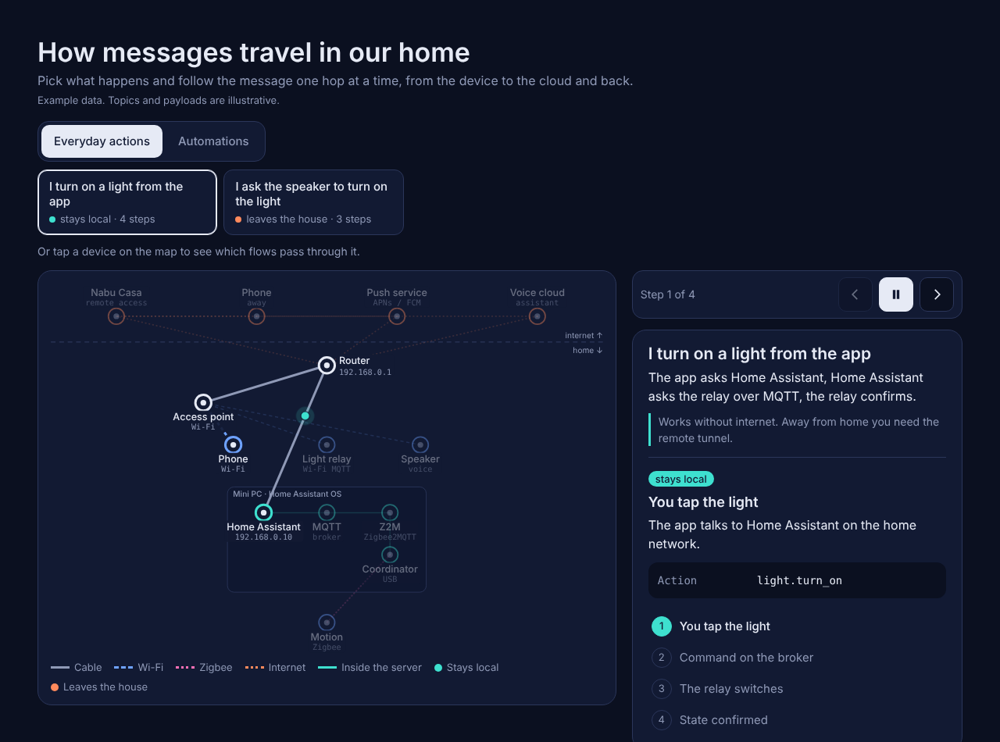

# Home Flow Explorer

A Lovelace card that shows how messages actually travel through your smart home. Pick something that happens ("I turn on a light from the app", "motion in the hallway at night") and a packet walks the path hop by hop: device, Wi-Fi or Zigbee, broker, Home Assistant, automation engine, cloud and back. Each hop shows what is sent (service, topic, payload, event) and whether it stays local or leaves the house.



It is a documentation tool more than a control panel. It answers questions like "what stops working if the internet goes down?" or "why does this light need the cloud?".

- Two groups of flows: everyday actions and automations
- Tap a device on the map to see every flow that passes through it
- Separate layouts for desktop and phone, automatic or hand-tuned
- Follows the Home Assistant theme, light and dark
- English and Italian
- No dependencies, one file, no data inside the code

## Install

### Marketplace / HACS (custom repository)

1. In Home Assistant open **Settings → Marketplace** (HACS on 2026.10 and older).
2. Add `https://github.com/bonello78/home-flow-explorer` as a custom repository of type **Dashboard**.
3. Install **Home Flow Explorer**. The resource is registered for you.

### Manual

Copy `home-flow-explorer.js` to `/config/www/` and add it as a dashboard resource of type **module**: `/local/home-flow-explorer.js?v=1.0.0`. Bump the `v` value on every update, otherwise phones keep the cached copy.

## Use

Add a **panel** view (the card needs the full width) with one card:

```yaml
type: custom:home-flow-explorer
title: How messages travel in our home
nodes: [...]
edges: [...]
scenarios: [...]
```

A complete example lives in [`examples/demo.yaml`](examples/demo.yaml). Open [`examples/demo.html`](examples/demo.html) in a browser to try it without Home Assistant.

**Your data is your network map.** IP addresses, entity names and the shape of your network end up in the card configuration. Put the view in a dashboard restricted to administrators, and never write passwords, tokens, webhook URLs or alarm codes in it.

## Configuration

| Key | Required | Description |
|---|---|---|
| `nodes` | yes | Things on the map |
| `edges` | yes | Links between nodes |
| `scenarios` | yes | The flows to play |
| `title` | no | Heading |
| `intro` | no | Text under the heading (a default is provided) |
| `note` | no | Small print, e.g. "values are examples" |
| `boxes` | no | Containers for server nodes, e.g. a VM or a NAS |
| `language` | no | `en` or `it`. Defaults to the Home Assistant language |
| `group_labels` | no | Override the tab names, e.g. `{everyday: Daily}` |
| `start` | no | Id of the scenario shown first |
| `autoplay` | no | `false` to wait for the play button |
| `layout` | no | Hand-placed coordinates, see below |

### Nodes

```yaml
- id: ha                 # short and unique
  name: Home Assistant   # keep it under ~14 characters
  sub: 192.168.0.10      # second line: address, technology or role
  zone: server           # cloud | net | server | device
  box: minipc            # server nodes only, refers to boxes[].id
  info: One or two sentences shown when the node is tapped.
```

Zones set the place on the map: cloud services on top, then the router (the first `net` node) and access points or switches, then Wi-Fi devices, the server boxes, and finally devices attached to a server (Zigbee, USB).

### Edges

`[from, to, medium]`, where medium is `cable`, `wifi`, `zigbee`, `internet` or `internal` (between processes on the same machine).

### Scenarios

```yaml
- id: light-app
  group: everyday          # everyday | automations (or gesti | automazioni)
  title: I turn on a light from the app
  summary: One sentence about the whole path.
  offline: What happens without internet.
  steps:
    - title: You tap the light
      path: [phone, ap, router, ha]   # every consecutive pair must be an edge
      out: false                      # true when the hop uses the internet
      text: One or two sentences.
      data: [[Action, light.turn_on], [Topic, "relay/<id>/command"]]
```

A path follows the physical network: a command from Home Assistant to a Wi-Fi relay goes `[mqtt, ha, router, ap, relay]`, not straight `[ha, relay]`. A step with a single node shows the packet pulsing there.

### Hand-tuned layout

The automatic layout is fine for small homes. For a busy map, place nodes yourself on a 1200-wide canvas (desktop) and a 400-wide one (phone):

```yaml
layout:
  desktop:
    boundary: 140          # y of the internet/home line
    height: 690
    boxes: [[775, 340, 420, 215, "Proxmox · VM"]]   # x, y, width, height, label
    nodes: {ha: [985, 395, d], router: [520, 200, r]}
  mobile:
    boundary: 226
    height: 1080
    nodes: {ha: [190, 740, d]}
```

The third value places the label: `u` above, `d` below, `l` left, `r` right. Nodes missing from `layout.nodes` keep their automatic position.

## Troubleshooting

- **"Configuration error" on the phone right after installing**: the companion app loads resources only at start. Reset the frontend cache (Settings → Companion app → Debugging) and restart the app.
- **Blank map**: open the browser console or set `debug: true` on the card. The card then writes its size and any drawing error to the Home Assistant log (logger `home_flow_explorer`).

## Development

Everything is in `home-flow-explorer.js`. `examples/demo.html` inlines it, so after a change copy the file content into the demo's script tag and open the page. Test on Safari or an iPhone too: WebKit treats inline SVG differently from Chrome.

## License

MIT
